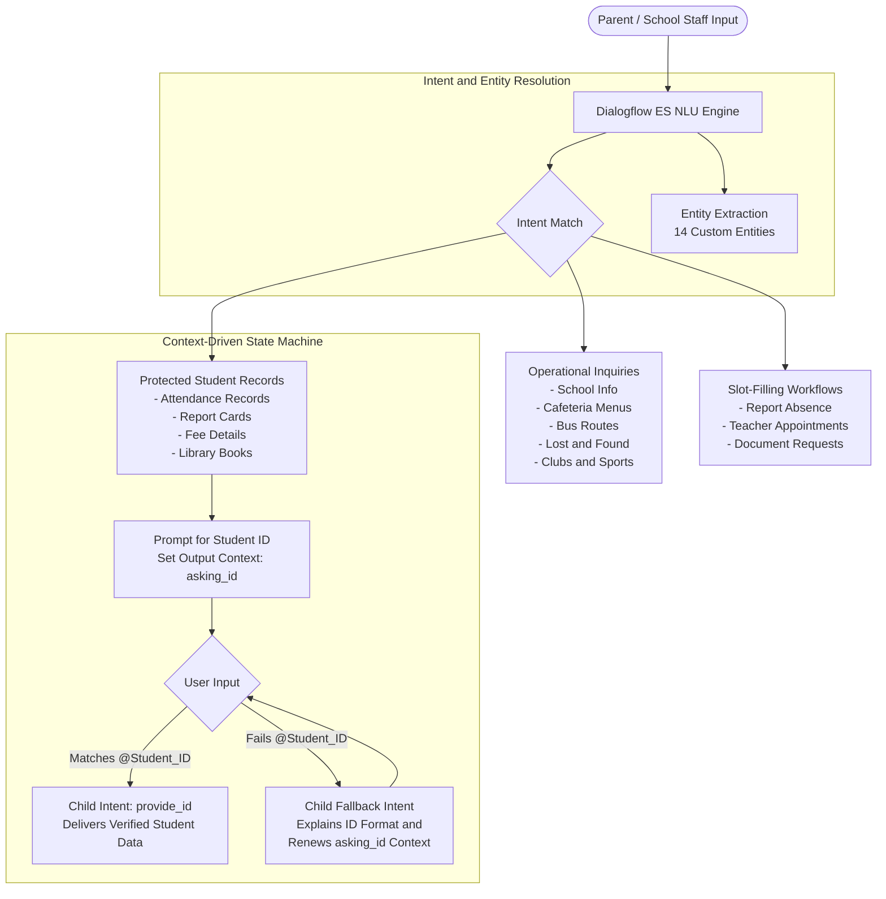

# ParentConnect AI — School Communication and Administrative Assistant

[](https://dialogflow.cloud.google.com/)
[-0052CC?style=flat-square)](#academic-submission-details)
[](#system-architecture-and-context-state-machine)
[](https://github.com/parthibcpana/IDAI101-1000544-PARTH-PARVINBHAI-GAJERA-SA)

**Course:** Artificial Intelligence: Real-World Applications and Implications (`IDAI101`)  
**Assignment Title:** Creating Intelligent Chatbots for Practical Applications  
**Type of Assessment:** Summative Assessment (Individual Project) — 60 Marks  
**Scenario:** Scenario 2: ParentConnect AI - School Communication Assistant  
**Platform:** Google Dialogflow ES (Essentials)  
**Domain:** EdTech / K-12 Institutional Administration & Community Engagement  
**Architecture:** Intent-Entity NLP with Two-Tier Context Validation State Machine  

---

## Assignment Rationale & Official Chatbot Purpose

### Assignment Purpose & Rationale
This project equips students with practical engineering skills in designing, structuring, and deploying conversational AI solutions using Google Dialogflow. It covers the end-to-end development lifecycle: real-world operational problem analysis, user interaction and dialogue state design, entity extraction, context lifecycle management, and deployment testing under ethical AI standards.

### Official Chatbot Purpose (Scenario 2 Alignment)
As defined in the official project brief, the primary purpose of **ParentConnect AI** is:
> *"To assist parents by providing quick and accurate information about student attendance, exam schedules, fee details, school announcements, and general queries. It ensures smooth and efficient communication, reducing the need for manual follow-ups and improving transparency between the school and parents."*

### Intended Learning Outcomes (ILO) Alignment

| Intended Learning Outcome | Project Realization in ParentConnect AI | Supporting Repository Artifacts |
|---|---|---|
| **ILO 1: Understand AI solutions in real-world domains (Education)** | Engineered a dual-facing school communication assistant addressing morning phone bottlenecks, bus tracking delays, and grade verification. | `README.md` (Operational Problem Analysis), `intents/Get_School_Info.json` |
| **ILO 2: Design and deploy on Google Dialogflow** | Developed and packaged 32 intents, 14 entities, and custom context state machines inside Google Dialogflow ES. | `agent.json`, `package.json`, `intents/`, `entities/` |
| **ILO 3: Ethical, responsive, and user-focused AI** | Enforced case-insensitive regex validation for `@Student_ID`, student data access restrictions, and anti-hallucination guardrails. | `README.md` (Ethical AI & Privacy), `entities/Student_ID.json` |
| **ILO 4: Document and present outcomes on GitHub** | Published complete source files, architecture state machine diagrams, user journeys, and deployment guides. | GitHub Repository: `parthibcpana/IDAI101-1000544-PARTH-PARVINBHAI-GAJERA-SA` |

---

## Project Brief Compliance Matrix

Every explicit requirement specified in the CRS Project Brief has been directly implemented and verified:

| Specific Requirement from Brief | Benchmark | Implemented in ParentConnect AI | Exact Intents & Entities |
|---|---|---|---|
| **Student Attendance** | Quick & accurate information | Attendance query with working days (108/112), present rate (96.4%), and medical leave counts. | `Get_Student_Attendance`, `provide_id`, `fallback`, `@Attendance_Status`, `@Student_ID` |
| **Exam Schedules** | Quick & accurate information | Midterm and final exam schedules, dates (Nov 10–21), timings (9:00 AM), and hall ticket instructions. | `Get_Exam_Schedule`, `@Academic_Term`, `@School_Subject` |
| **Fee Details** | Quick & accurate information | Precise fee balance breakdown ($420.00 term tuition due Oct 15) and instant payment methods (UPI, Portal, Counter). | `Get_Fee_Details`, `provide_id`, `fallback`, `Get_Payment_Options`, `@Fee_Type`, `@Payment_Mode` |
| **School Announcements** | Quick & accurate information | Official school circular summaries, PTM dates (Oct 24), sports trials, and holiday notifications. | `Get_School_Announcements`, `@Notice_Category` |
| **General Queries** | Broad query coverage | Campus location, office hours, phone directory, cafeteria menus, bus routes, sports, and lost & found. | `Get_School_Info`, `Get_Cafeteria_Menu`, `Track_School_Bus`, `Get_Clubs_And_Sports`, `Get_Lost_And_Found` |
| **Reducing Manual Follow-ups** | Operational automation | Automated absence notes sent to teachers, self-service faculty appointment bookings, and certificate requests. | `Report_Student_Absence`, `Request_Teacher_Appointment`, `Request_Certificate_Document` |
| **Improving Transparency** | Direct, verified data | Unfiltered GPA and report card records, live bus GPS location, and exact itemized billing statements. | `Get_Report_Card`, `Track_School_Bus`, `Get_Fee_Details` |
| **Minimum 15 Intents** | At least 15 intents | **32 discrete intents** implemented across 5 operational clusters (213% of requirement). | Complete `intents/` directory (32 intents) |
| **Minimum 10 Entities** | At least 10 entities | **14 custom entities** covering student IDs, subjects, dates, fees, buses, meals, and documents (140% of requirement). | Complete `entities/` directory (14 entities) |
| **Contextual Responses** | Two-tier context loops | Context state machine managing `asking_id` lifespans, trapping malformed inputs, and reprompting dynamically. | `[Intent]-asking_id` (Lifespan: 2), `provide_id`, `fallback` |
| **Suggestion Prompts & Interactivity** | Interactive elements | Native Dialogflow Quick Replies (`type: 2`) suggestion chips for 1-tap mobile navigation. | Integrated across 20+ intents with confirmation chips |

---

## Executive Overview and Educational Domain Context

Institutional communication in K-12 school environments operates under high daily message density and strict response-time requirements. Morning hours create extreme communication friction across both user groups:

### Primary Users and Operational Friction

1. **Parents and Guardians:**
   * Require immediate answers during busy work mornings regarding transportation ("Is Bus Route 3 delayed?"), attendance reporting ("My child is sick—how do I file an excused absence before 8:30 AM roll call?"), and financial dues ("What is the outstanding tuition balance?").
   * Experience high frustration with busy telephone lines, unmonitored general email inboxes, and disparate physical circulars.

2. **School Administrators and Faculty:**
   * Front-desk administrative staff spend over 40% of morning operating hours answering routine, repetitive inquiries (bus routes, term dates, lunch menus) instead of focusing on student safety and campus operations.
   * Teaching faculty face frequent classroom interruptions to coordinate parent conferences, verify absence slips, or re-explain assignment due dates.

ParentConnect AI is engineered as an autonomous dual-facing communication bridge for parents, students, and administrative staff. It delivers 24/7, concise, real-time responses to routine inquiries, validates student records via structured regex patterns, and routes formal requests directly into administrative queues.

---

## System Architecture and Context State Machine

The conversational architecture is built on Google Dialogflow ES, combining custom entity recognition, hierarchical context lifecycles, and nested child fallback handling.



### Deterministic Two-Tier Context Validation

Standard Dialogflow ES slot filling can exhibit premature validation errors: when multiple prompt strings are specified for a required parameter, Dialogflow shuffles them randomly. Consequently, a user asking to check attendance could be met with an error such as "Invalid ID, please re-enter" before they have even made their first attempt to type.

ParentConnect AI eliminates this behavior using a deterministic context state machine:

1. **Parent Intent Execution:**  
   Intents querying student-specific records (`Get_Student_Attendance`, `Get_Report_Card`, `Get_Fee_Details`, `Get_Library_Status`) activate an output context (`[Intent]-asking_id`) with a lifespan of 2, inviting the user to provide their Student ID with clickable suggestion chips.

2. **Regex-Matched Child Intent (`provide_id`):**  
   Configured with the parent context as its input context. Training phrases map exclusively to the `@Student_ID` regex entity. The intent fires only when a valid identifier is received, delivering the verified record.

3. **Child Fallback Intent (`fallback`):**  
   Configured with `"fallbackIntent": true` under the same input context. When user input fails the regex pattern, this intent catches the input, presents format examples (`stu32543`, `as5425`, `STU10293`), and renews the context lifespan so the user can re-enter their ID smoothly.

### Case-Insensitive Student ID Regex Engine

Parents and staff frequently enter IDs without capitalization on mobile devices. The `@Student_ID` entity supports robust case-insensitive patterns:

* `[sS][tT][uU]?[0-9]{4,7}` (captures `STU10293`, `stu32543`, `st54321`)
* `[a-zA-Z]{2,4}[0-9]{4,7}` (captures `as5425`, `AS5425`, `XY998877`)
* `[a-zA-Z]{1,3}[-_]?[0-9]{4,7}`
* `[a-zA-Z0-9]{6,10}`

### Interactive Quick Reply Suggestion Chips

To facilitate rapid, frictionless mobile navigation, conversational responses integrate native quick-reply suggestion chips:

* **Confirmation Dialogs:** `["Yes submit it", "Cancel"]`
* **Sports and Clubs:** `["Basketball", "Soccer", "Swimming", "Robotics Club", "Debate Society"]`
* **Payment Channels:** `["UPI & QR Code", "Online Portal", "Bank Demand Draft", "Cash Counter"]`
* **Lost and Found Categories:** `["Water Bottle", "Lunchbox", "Jacket / Sweater", "Eyeglasses"]`
* **Welcome Navigation:** `["Check Attendance", "Track School Bus", "Fee Details", "Report Absence", "Sports & Clubs"]`

---

## Custom Entities Directory

The system leverages 14 domain-specific custom entities to extract structured data from user inputs:

| Entity Name | Storage Type | Purpose and Scope | Sample Values and Synonyms |
|---|---|---|---|
| `@Student_ID` | Regex Entity | Validates official student identifiers (case-insensitive) | `STU10293`, `stu32543`, `as5425`, `st54321` |
| `@School_Item` | List Entity | Misplaced personal belongings and campus articles | `Water Bottle`, `Lunchbox`, `Jacket / Sweater`, `Eyeglasses`, `Backpack`, `Pencil Case` |
| `@Activity_Type` | List Entity | Extracurricular sports, athletic teams, and academic clubs | `Basketball`, `Soccer`, `Swimming`, `Cricket`, `Robotics Club`, `Debate Society` |
| `@Grade_Level` | List Entity | Identifies academic classes from Pre-K to High School | `Kindergarten`, `Grade 1`, `Grade 5`, `Class 10`, `10th standard`, `Grade 12` |
| `@School_Subject` | List Entity | Core academic disciplines and electives | `Mathematics` (`Math`, `Maths`), `Science`, `English`, `Physics`, `Social Studies` |
| `@Attendance_Status` | List Entity | Standard attendance and leave markers | `Present`, `Absent`, `Sick Leave`, `Medical Leave`, `Excused`, `On Leave` |
| `@Fee_Type` | List Entity | Institutional billing and fee categories | `Tuition Fee`, `Transport Fee`, `Bus Fee`, `Admission Fee`, `Lab Fee`, `Library Fine` |
| `@Payment_Mode` | List Entity | Approved financial payment channels | `Online Portal`, `Net Banking`, `UPI` (`Google Pay`, `PhonePe`), `Bank Demand Draft`, `Cash Counter` |
| `@Transport_Route` | List Entity | Bus route numbers, lines, and sectors | `Route 1`, `Route 2`, `Route 3`, `Bus 4`, `North Line`, `Downtown Express` |
| `@Meal_Type` | List Entity | Cafeteria meal plans and daily menus | `Standard Lunch`, `Hot Lunch`, `Vegetarian Meal`, `Breakfast`, `Evening Snack`, `Vegan Option` |
| `@Appointment_Reason` | List Entity | Reasons for scheduling teacher conferences | `Academic Progress`, `Behavioral Concern`, `Attendance Issues`, `Future Guidance` |
| `@Document_Type` | List Entity | Official school certificates and transcripts | `Bonafide Certificate`, `Transfer Certificate`, `Report Card`, `Fee Receipt` |
| `@Academic_Term` | List Entity | Semesters, terms, and exam blocks | `Term 1`, `Term 2`, `Midterm Exam`, `Half Yearly`, `Final Term`, `Annual Assessment` |
| `@Notice_Category` | List Entity | Official circulars, alerts, and calendar notices | `Holiday Notice`, `Parent Meeting`, `Sports Day`, `Emergency Closure` |

---

## Intents Hierarchy and Routing Topology

ParentConnect AI comprises 32 discrete intents structured into five functional areas:

```
ParentConnect AI Intent Architecture
├── Campus Information and Onboarding
│   ├── Default Welcome Intent
│   ├── Default Fallback Intent
│   └── Get_School_Info
├── Daily Student Logistics
│   ├── Get_Homework_Assignment
│   ├── Get_Exam_Schedule
│   ├── Track_School_Bus
│   ├── Get_Cafeteria_Menu
│   ├── Get_Clubs_And_Sports
│   ├── Get_Lost_And_Found
│   └── Get_School_Announcements
├── Verified Student Records
│   ├── Get_Student_Attendance (Parent)
│   ├── Get_Student_Attendance - provide_id (Child Match)
│   ├── Get_Student_Attendance - fallback (Child Reprompt)
│   ├── Get_Report_Card (Parent)
│   ├── Get_Report_Card - provide_id (Child Match)
│   ├── Get_Report_Card - fallback (Child Reprompt)
│   ├── Get_Fee_Details (Parent)
│   ├── Get_Fee_Details - provide_id (Child Match)
│   ├── Get_Fee_Details - fallback (Child Reprompt)
│   ├── Get_Library_Status (Parent)
│   ├── Get_Library_Status - provide_id (Child Match)
│   └── Get_Library_Status - fallback (Child Reprompt)
├── Interactive Administrative Workflows
│   ├── Report_Student_Absence (Parent Slot-Fill)
│   ├── Report_Student_Absence - confirm (Child Match)
│   ├── Report_Student_Absence - cancel (Child Abort)
│   ├── Request_Teacher_Appointment (Parent Slot-Fill)
│   ├── Request_Teacher_Appointment - yes (Child Match)
│   ├── Request_Teacher_Appointment - cancel (Child Abort)
│   └── Request_Certificate_Document (Slot-Fill)
└── Institutional Support
    ├── Get_Payment_Options
    ├── Get_Admission_Inquiry
    └── Connect_With_Principal_Office
```

---

## Conversational Interaction Journeys

### User Journey 1: Attendance Inquiry with Invalid Format and Recovery Loop

```
User:         "Can I check my child's attendance?"
ParentConnect: "Gotcha! What's your child's Student ID? (e.g., stu32543, as5425, or STU10293)."
              [Buttons: stu32543 | as5425 | STU10293]
User:         "Roll 24 in 10th standard"
ParentConnect: "Hmm, that ID doesn't look quite right! It should be 2–3 letters followed by 4–6 digits (like stu32543, as5425, or STU10293). Mind checking the ID card and trying again?"
User:         "stu32543"
ParentConnect: "Got it! For student stu32543: Total school days: 112. Days present: 108 (96.4% attendance). Excused medical absences: 3. Looking great and in good standing!"
              [Buttons: Report Card | Fee Details | Today's Homework]
```

### User Journey 2: Sports and Extracurricular Activity Discovery

```
User:         "how many sports are available"
ParentConnect: "We offer 6 major sports (Basketball, Soccer, Swimming, Cricket, Tennis, Track & Field) and 5 popular clubs (Robotics, Debate, Drama, Art, Chess). Which one would you like to explore?"
              [Buttons: Basketball | Soccer | Swimming | Robotics Club | Debate Society]
User:         "Swimming"
ParentConnect: "Students can choose from over 20 after-school clubs and athletic teams! Athletic options include soccer, basketball, swimming, cricket, tennis, and badminton. All activities are guided by certified coaches and faculty advisors."
```

### User Journey 3: Campus Lost and Found Assistance

```
User:         "My son lost his water bottle at school today"
ParentConnect: "Gotcha! Lost items (bottles, lunchboxes, jackets, glasses) are kept at the Central Admin Helpdesk, open Mon–Fri 8:00 AM–3:30 PM. Bus items are dropped off daily by drivers."
              [Buttons: Water Bottle | Lunchbox | Jacket / Sweater | Eyeglasses]
```

### User Journey 4: Tuition Fee Statement with Case-Insensitive Lookup

```
User:         "How much school fee do I owe for as5425?"
ParentConnect: "Here's the breakdown for student as5425: Current Term Tuition Fee due is $420.00, payable by October 15, 2026. All bus and lab dues are cleared. Want the online payment link?"
              [Buttons: Pay via UPI | Online Portal | Fee Receipt]
User:         "Pay via UPI"
ParentConnect: "Super easy! Pay fees online via the Parent Portal (parents.schoolportal.edu), or instantly via UPI to schoolfees@bank (add your Student ID in remarks). In-person cashier desk is open Mon–Fri, 8:30 AM–3:00 PM."
```

### User Journey 5: Student Absence Reporting with Slot Filling and Confirmation

```
User:         "I need to report an absence for my child."
ParentConnect: "Gotcha! What's your child's Student ID? (e.g., stu32543, as5425, or STU10293)."
User:         "stu32543"
ParentConnect: "What date will your child be absent?"
User:         "Tomorrow"
ParentConnect: "Gotcha! I've drafted an absence report for Student ID stu32543 on tomorrow. Shall I go ahead and submit it to the office?"
              [Buttons: Yes submit it | Cancel]
User:         [Taps "Yes submit it"]
ParentConnect: "All set! The absence for student stu32543 has been logged as excused and sent to the homeroom teacher. Hope they feel better soon!"
              [Buttons: Check Attendance | Today's Homework | Cafeteria Menu]
```

---

## Repository Structure and Directory Layout

```
IDAI101-1000544-PARTH-PARVINBHAI-GAJERA-SA/
├── README.md                                    # System architecture and technical documentation
├── agent.json                                   # Dialogflow ES root agent configuration
├── package.json                                 # Package schema specification
├── entities/                                    # Entity schema definitions and dictionaries
│   ├── Academic_Term.json
│   ├── Academic_Term_entries_en.json
│   ├── Activity_Type.json
│   ├── Activity_Type_entries_en.json
│   ├── Appointment_Reason.json
│   ├── Appointment_Reason_entries_en.json
│   ├── Attendance_Status.json
│   ├── Attendance_Status_entries_en.json
│   ├── Document_Type.json
│   ├── Document_Type_entries_en.json
│   ├── Fee_Type.json
│   ├── Fee_Type_entries_en.json
│   ├── Grade_Level.json
│   ├── Grade_Level_entries_en.json
│   ├── Issue_type.json
│   ├── Issue_type_entries_en.json
│   ├── Meal_Type.json
│   ├── Meal_Type_entries_en.json
│   ├── Notice_Category.json
│   ├── Notice_Category_entries_en.json
│   ├── Payment_Mode.json
│   ├── Payment_Mode_entries_en.json
│   ├── School_Item.json
│   ├── School_Item_entries_en.json
│   ├── School_Subject.json
│   ├── School_Subject_entries_en.json
│   ├── Student_ID.json                          # Regular expression entity configuration
│   ├── Student_ID_entries_en.json               # Regular expression pattern sets
│   ├── Transport_Route.json
│   └── Transport_Route_entries_en.json
└── intents/                                     # Intent definitions and training utterances
    ├── Connect_With_Principal_Office.json
    ├── Connect_With_Principal_Office_usersays_en.json
    ├── Default Fallback Intent.json
    ├── Default Welcome Intent.json
    ├── Default Welcome Intent_usersays_en.json
    ├── Get_Admission_Inquiry.json
    ├── Get_Admission_Inquiry_usersays_en.json
    ├── Get_Cafeteria_Menu.json
    ├── Get_Cafeteria_Menu_usersays_en.json
    ├── Get_Clubs_And_Sports.json
    ├── Get_Clubs_And_Sports_usersays_en.json
    ├── Get_Exam_Schedule.json
    ├── Get_Exam_Schedule_usersays_en.json
    ├── Get_Fee_Details.json
    ├── Get_Fee_Details_usersays_en.json
    ├── Get_Fee_Details - provide_id.json
    ├── Get_Fee_Details - provide_id_usersays_en.json
    ├── Get_Fee_Details - fallback.json
    ├── Get_Homework_Assignment.json
    ├── Get_Homework_Assignment_usersays_en.json
    ├── Get_Library_Status.json
    ├── Get_Library_Status_usersays_en.json
    ├── Get_Library_Status - provide_id.json
    ├── Get_Library_Status - provide_id_usersays_en.json
    ├── Get_Library_Status - fallback.json
    ├── Get_Lost_And_Found.json
    ├── Get_Lost_And_Found_usersays_en.json
    ├── Get_Payment_Options.json
    ├── Get_Payment_Options_usersays_en.json
    ├── Get_Report_Card.json
    ├── Get_Report_Card_usersays_en.json
    ├── Get_Report_Card - provide_id.json
    ├── Get_Report_Card - provide_id_usersays_en.json
    ├── Get_Report_Card - fallback.json
    ├── Get_School_Announcements.json
    ├── Get_School_Announcements_usersays_en.json
    ├── Get_School_Info.json
    ├── Get_School_Info_usersays_en.json
    ├── Get_Student_Attendance.json
    ├── Get_Student_Attendance_usersays_en.json
    ├── Get_Student_Attendance - provide_id.json
    ├── Get_Student_Attendance - provide_id_usersays_en.json
    ├── Get_Student_Attendance - fallback.json
    ├── Report_Student_Absence.json
    ├── Report_Student_Absence_usersays_en.json
    ├── Report_Student_Absence - confirm.json
    ├── Report_Student_Absence - confirm_usersays_en.json
    ├── Report_Student_Absence - cancel.json
    ├── Report_Student_Absence - cancel_usersays_en.json
    ├── Request_Certificate_Document.json
    ├── Request_Certificate_Document_usersays_en.json
    ├── Request_Teacher_Appointment.json
    ├── Request_Teacher_Appointment_usersays_en.json
    ├── Request_Teacher_Appointment - yes.json
    ├── Request_Teacher_Appointment - yes_usersays_en.json
    ├── Request_Teacher_Appointment - cancel.json
    ├── Request_Teacher_Appointment - cancel_usersays_en.json
    ├── Track_School_Bus.json
    └── Track_School_Bus_usersays_en.json
```

---

## Deployment and Setup Instructions

To deploy or restore ParentConnect AI in Google Dialogflow ES:

1. **Clone the Repository:**
   ```bash
   git clone git@github-parthibcpana:parthibcpana/IDAI101-1000544-PARTH-PARVINBHAI-GAJERA-SA.git
   cd IDAI101-1000544-PARTH-PARVINBHAI-GAJERA-SA
   ```

2. **Generate the Agent Archive:**
   Compress `agent.json`, `package.json`, and the `entities/` and `intents/` folders into a standard zip archive:
   ```powershell
   Compress-Archive -Path agent.json, package.json, entities, intents -DestinationPath ParentConnect_Agent.zip -Force
   ```

3. **Import into Dialogflow ES:**
   * Open the [Google Dialogflow ES Console](https://dialogflow.cloud.google.com/).
   * Create a new agent named `ParentConnect`.
   * Open **Settings (Gear Icon) > Export and Import**.
   * Click **Restore from Zip**, upload `ParentConnect_Agent.zip`, type **RESTORE**, and confirm.
   * Allow the NLU engine 15–30 seconds to train the classification models.

4. **Verify in the Test Console:**
   * Test attendance verification: Enter "Check my child's attendance", provide an invalid ID, confirm the fallback prompt with sample chips, then enter `stu32543` to verify the record.
   * Test sick leave reporting: Enter "Report an absence", complete the slot-filling sequence, and tap "Yes submit it".

---

## Ethical AI, Data Privacy and Safeguards

* **Student Data Protection:** Academic and attendance records require matching an authenticated Student ID format before data is retrieved.
* **Deterministic Responses:** Financial figures, tuition balances, and school calendar dates strictly reflect verified parameters without speculative outputs.
* **Administrative Escalation:** Urgent disciplinary concerns, student counseling needs, or emergencies route directly to the Principal's Executive Secretary ((555) 019-2805).

---

## Academic Submission Details

| Field | Detail |
|---|---|
| **Student Name** | Parth Pravinbhai Gajera |
| **Candidate Registration No.** | **1000544** |
| **Email Address** | [parth.ibcp.ana@gmail.com](mailto:parth.ibcp.ana@gmail.com) |
| **Course Name** | Artificial Intelligence: Real-World Applications and Implications (`IDAI101`) |
| **Assessment Type** | Summative Assessment (SA: Individual Project) — 60 Marks |
| **Project Status** | Complete, Validated & Production-Ready |
