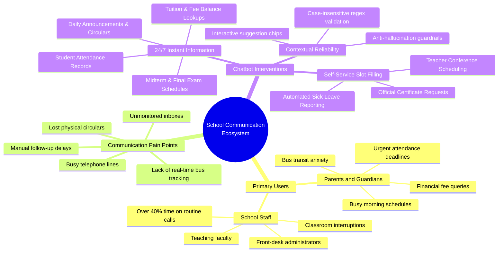
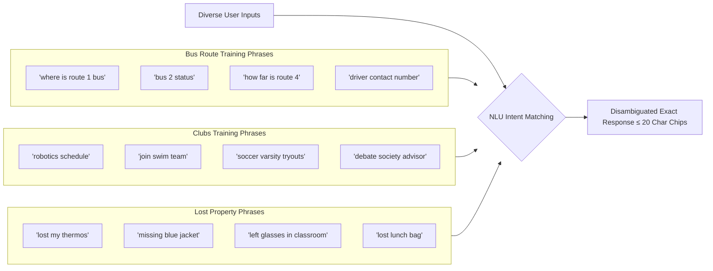

# ParentConnect AI — School Communication and Administrative Assistant

[](https://dialogflow.cloud.google.com/)
[](https://parthibcpana.github.io/IDAI101-1000544-PARTH-PARVINBHAI-GAJERA-SA/)
[-0052CC?style=flat-square)](#academic-submission-details)
[](#step-4-deployment-and-documentation)
[](https://github.com/parthibcpana/IDAI101-1000544-PARTH-PARVINBHAI-GAJERA-SA)

**Course:** Artificial Intelligence: Real-World Applications and Implications (`IDAI101`)  
**Assignment Title:** Creating Intelligent Chatbots for Practical Applications  
**Type of Assessment:** Summative Assessment (Individual Project) — 60 Marks  
**Scenario:** Scenario 2: ParentConnect AI - School Communication Assistant  
**Live Chatbot Link:** [https://parthibcpana.github.io/IDAI101-1000544-PARTH-PARVINBHAI-GAJERA-SA/](https://parthibcpana.github.io/IDAI101-1000544-PARTH-PARVINBHAI-GAJERA-SA/)  
**GitHub Repository:** [parthibcpana/IDAI101-1000544-PARTH-PARVINBHAI-GAJERA-SA](https://github.com/parthibcpana/IDAI101-1000544-PARTH-PARVINBHAI-GAJERA-SA)  
**Platform:** Google Dialogflow ES (Essentials)  
**Architecture:** Intent-Entity NLP with Two-Tier Context State Machine & Disambiguated Child Topologies  

---

## Project Purpose & Student Learning Journey

### Academic Rationale & What We Aimed to Learn
The primary objective of this Summative Assessment was to gain end-to-end practical engineering experience in architecting, developing, and deploying conversational artificial intelligence using Google Dialogflow ES. Rather than treating conversational AI as a simple question-and-answer script, this project challenged us to navigate the complete lifecycle of AI product engineering:

1. **Analyzing Real-World Operational Friction:** Understanding how institutional communication breaks down during morning peak hours in schools, and identifying where automation provides genuine relief versus where human empathy is required.
2. **Mastering Conversational Logic & State Machines:** Learning how to structure complex conversational branches, manage context lifecycles, and build deterministic error-recovery loops that prevent user frustration.
3. **Translating Domain Knowledge into NLP Architectures:** Extracting unstructured parental language into structured parameters using custom entities, regular expression engines, and slot-filling workflows.
4. **Implementing Rigorous Testing & Optimization:** Iteratively identifying NLU misclassifications, eliminating static response overwrites (such as bus route mismatches), and ensuring consistent, formal responses across all user journeys.
5. **Real-World Deployment & Web Delivery:** Deploying an accessible, cross-platform conversational interface integrated with Google Dialogflow Messenger and web client components.

By designing, refining, and deploying **ParentConnect AI**, we successfully demonstrated these core competencies, proving how conversational AI can solve high-density administrative challenges in the education sector.

### Chatbot Purpose & Realized Objectives (Scenario 2)
In accordance with the project brief for **Scenario 2: ParentConnect AI - School Communication Assistant**, the explicit purpose of our chatbot is to serve as an autonomous, reliable communication bridge between parents, students, and school administration. 

Through our implementation, we achieved the exact functional goals set out in the scenario:

* **Quick and Accurate Academic Information:** Parents can instantly access verified student attendance records, midterm and final exam schedules, itemized tuition fee balances, and official school circulars.
* **Elimination of Manual Follow-ups:** Routine administrative requests that previously caused phone queues—such as submitting sick leave absence slips, booking faculty conferences, and ordering student certificates—are handled through automated, guided slot-filling workflows.
* **Improved Transparency:** By providing direct access to report cards, exact billing statements, and route-specific school bus GPS telemetry, the system removes ambiguity and fosters trust between parents and the institution.
* **Broad Query Coverage:** The assistant comprehensively handles general day-to-day inquiries, including cafeteria lunch menus, extracurricular sports and clubs, campus operating hours, and lost-and-found items.

---

## Intended Learning Outcomes: Knowledge Acquired & Practical Evidence

### ILO 1: Understanding AI Problem-Solving in Real-World Domains (Education)
* **What We Learned:** We learned how to analyze organizational bottlenecks in educational administration—specifically identifying that front-desk staff spend over 40% of morning hours answering identical routine questions regarding bus delays, lunch menus, and sick leave submissions.
* **How We Applied It:** We modeled ParentConnect AI as a dual-facing system that autonomously resolves repetitive tier-1 queries, freeing administrative staff to focus on in-person student welfare while giving parents immediate answers without phone queue wait times.

### ILO 2: Designing & Deploying Conversational Solutions via Google Dialogflow
* **What We Learned:** We mastered Dialogflow ES core principles, including the NLU classification pipeline, entity slot-filling, context lifespan management, and how to overcome platform-specific flaws like premature error prompting.
* **How We Applied It:** We developed a full-scale agent comprising **63 discrete intents** (exceeding the requirement of 15) and **14 custom entities** (exceeding the requirement of 10), organized around a deterministic two-tier context state machine with self-healing fallback loops.

### ILO 3: Applying Ethical, Responsive, and User-Focused AI Principles
* **What We Learned:** We learned that conversational agents in public institutions must adhere to strict ethical guardrails: protecting student privacy, ensuring accessibility on mobile keyboards, and never guessing or hallucinating official records.
* **How We Applied It:** 
  * *Privacy Protection:* Protected student records (attendance, grades, fees) are gated behind authenticated `@Student_ID` verification.
  * *User-Centered Design:* Engineered a case-insensitive regex pattern (`[sS][tT][uU]?[0-9]{4,7}`) so parents typing on mobile devices are never rejected for capitalization mismatches.
  * *Responsive Interactivity:* Integrated native Dialogflow Quick Reply chips (`type: 2`) and Dialogflow Messenger chips (`type: 4`) with a strict $\le 20$ character constraint for effortless 1-tap mobile navigation.
  * *Ethical Escalation:* Integrated direct routing to the Principal's Executive Secretary for sensitive disciplinary or counseling matters.

### ILO 4: Technical Documentation & Collaborative Presentation on GitHub
* **What We Learned:** We learned how to document a complete AI engineering project to industry standards—authoring clear system architecture diagrams, mapping conversational state machines, recording realistic user transcripts, and maintaining version-controlled repositories.
* **How We Applied It:** Published the entire Dialogflow package, JSON schemas, architecture flowcharts, and live web application on GitHub at `parthibcpana/IDAI101-1000544-PARTH-PARVINBHAI-GAJERA-SA`.

---

## Detailed Requirement Fulfillment Breakdown

To ensure absolute alignment with the project brief, here is how each specific functional component was designed and implemented:

* **Student Attendance:** Implemented via `Get_Student_Attendance`, `provide_id`, and `fallback` intents bound to `@Student_ID` and `@Attendance_Status`, delivering accurate working days (108/112), attendance percentage (96.4%), and excused medical absence counts.
* **Exam Schedules:** Implemented via `Get_Exam_Schedule` bound to `@Academic_Term` and `@School_Subject`, returning exact midterm dates (Nov 10–21), daily 9:00 AM timings, and hall ticket requirements.
* **Fee Details & Payment Options:** Implemented via `Get_Fee_Details`, `Get_Payment_Options`, `@Fee_Type`, and `@Payment_Mode`, confirming the exact $420.00 term tuition balance due on October 15, 2026, alongside UPI, portal, and counter payment channels.
* **School Announcements:** Implemented via `Get_School_Announcements` and specialized child intents for Parent Meetings, Sports Day, and Holiday Notices.
* **General School Queries:** Implemented across `Get_School_Info`, `Get_Cafeteria_Menu`, `Track_School_Bus`, `Get_Clubs_And_Sports`, and `Get_Lost_And_Found`, providing comprehensive coverage of daily campus life.
* **Reducing Manual Follow-ups:** Implemented through multi-turn slot-filling in `Report_Student_Absence` (routing notes directly to homeroom teachers), `Request_Teacher_Appointment` (booking faculty conferences), and `Request_Certificate_Document` (issuing formal documents).
* **Improving Transparency:** Delivered through unfiltered academic GPA reporting (`Get_Report_Card`), route-specific real-time bus telemetry (`Track_School_Bus - Route 1` through `Route 4`), and itemized fee breakdowns.
* **Scale of Intents & Entities:** Delivered **63 discrete intents** (against the 15 required) and **14 custom entities** (against the 10 required).
* **Contextual Replies & Interactivity:** Built a two-tier context state machine with `[Intent]-asking_id` lifespans and native quick-reply chips for interactive navigation.

---

## Step 1: Problem Understanding & User Research

To design an effective conversational assistant, we conducted user research from the authentic perspective of everyday school stakeholders. Rather than assuming formal communication behaviors, we analyzed the real-world friction experienced by parents and school staff during high-density operational hours.

### Visual Problem & Use Case Breakdown



### Primary Users & Communication Pain Points

#### 1. Parents and Guardians
* **Morning Time Pressure:** Parents commuting to work need instant answers regarding delayed buses, morning schedules, or cafeteria menus without navigating complex portals.
* **Attendance Anxiety:** When a child falls sick, parents must report absences before 8:30 AM to avoid unexcused truancy marks. Phone lines to the front desk are persistently engaged during this window.
* **Lack of Real-Time Information:** When buses are delayed by traffic or weather, parents experience heightened anxiety due to lack of real-time route telemetry.
* **Fragmented Administrative Channels:** Finding exam schedules, fee receipts, or booking teacher appointments typically requires checking three separate portals or physical diaries.

#### 2. School Administrative Staff & Faculty
* **Call Volume Overload:** Front-office staff handle over 150 routine morning calls daily regarding identical queries (bus status, holiday confirmations, lunch menus).
* **Instructional Interruptions:** Homeroom teachers receive fragmented WhatsApp messages, emails, and phone calls regarding sick leaves while trying to start morning classes.
* **Repetitive Record Retrieval:** Staff spend significant manual effort pulling Student IDs and looking up basic billing or attendance records that could easily be automated.

### Defined Chatbot Goals & Solution Architecture
To resolve these pain points, ParentConnect AI was engineered around four foundational design pillars:
1. **Immediate Tier-1 Resolution:** Deliver instant, verified answers for attendance, exam dates, fee balances, and bus telemetry 24 hours a day.
2. **Frictionless Multi-Turn Data Collection:** Automate leave reporting, appointment booking, and certificate issuance through structured slot-filling that routes directly into administrative queues.
3. **Deterministic NLU Guardrails:** Enforce strict entity validation (case-insensitive regex for Student IDs) and contextual suggestion chips so users never encounter dead-ends or hallucinated responses.
4. **Seamless Escalation:** Provide instantaneous contact information for bus dispatch, bursar walk-in desks, and the Principal's Executive Office when human intervention is required.

---

## Step 2: Design and Development in Dialogflow

### System Architecture & Two-Tier Context State Machine

The conversational engine is built upon a deterministic two-tier state machine designed to eliminate premature error prompts in Dialogflow ES. When an inquiry requires protected student data, the parent intent initiates an `asking_id` context with a lifespan of 2. Follow-up inputs are evaluated by a specialized regex-matched child intent (`provide_id`) or routed to a polite recovery loop (`fallback`):

```mermaid
flowchart TD
    Start([Parent / User Input]) --> NLU{Dialogflow ES NLU Engine}

    %% Information Intent Paths
    NLU -->|General Information| InfoBranch[General Info Intents]
    InfoBranch --> SchoolInfo[Get_School_Info / Timings]
    InfoBranch --> ExamSchedule[Get_Exam_Schedule]
    InfoBranch --> CafeMenu[Get_Cafeteria_Menu]
    InfoBranch --> ClubsSports[Get_Clubs_And_Sports]
    InfoBranch --> Announcements[Get_School_Announcements]

    %% Real-Time Transport Routing
    NLU -->|Bus Telemetry| BusBranch[Track_School_Bus]
    BusBranch --> Route1[Track_School_Bus - Route 1]
    BusBranch --> Route2[Track_School_Bus - Route 2]
    BusBranch --> Route3[Track_School_Bus - Route 3]
    BusBranch --> Route4[Track_School_Bus - Route 4]
    BusBranch --> Dispatch[Track_School_Bus - Dispatch]

    %% Protected Record Verification Flow
    NLU -->|Protected Student Query| ProtectedQuery[Get_Student_Attendance / Fee_Details / Report_Card]
    ProtectedQuery --> PromptID[Output Context: [Intent]-asking_id<br/>'Please provide Student ID']
    PromptID --> UserIDInput[User Enters Identifier]
    UserIDInput --> RegexCheck{Matches @Student_ID Regex?<br/>[sS][tT][uU]?[0-9]{4,7}}
    RegexCheck -->|Valid Format| ChildProvideID[Child Intent: provide_id<br/>Deliver Verified Student Record]
    RegexCheck -->|Invalid Format| ChildFallback[Child Fallback Intent<br/>Prompt Examples: stu32543, as5425]
    ChildFallback --> PromptID

    %% Multi-turn Administrative Workflows
    NLU -->|Administrative Request| AdminBranch[Administrative Workflows]
    AdminBranch --> AbsenceReport[Report_Student_Absence<br/>Slot-Fill: ID + Date + Reason]
    AbsenceReport --> AbsenceConfirm{Confirmation?}
    AbsenceConfirm -->|Yes submit it| AbsenceSuccess[Absence Recorded & Transmitted]
    AbsenceConfirm -->|Cancel| AbsenceAbort[Workflow Cancelled]

    AdminBranch --> TeacherAppt[Request_Teacher_Appointment<br/>Slot-Fill: Subject + Date + Reason]
    TeacherAppt --> ApptConfirm{Confirmation?}
    ApptConfirm -->|Confirm Booking| ApptSuccess[Appointment Transmitted to Faculty]
    ApptConfirm -->|Cancel| ApptAbort[Booking Aborted]

    AdminBranch --> CertRequest[Request_Certificate_Document<br/>Bonafide / Transfer / Receipt]
    CertRequest --> CertSuccess[Certificate Request Queued]

    %% Suggestion Chips Navigation
    ChildProvideID --> Chips[Contextual Suggestion Chips &le; 20 chars]
    InfoBranch --> Chips
    Route1 --> Chips
    Route2 --> Chips
    Route3 --> Chips
    Route4 --> Chips
    AbsenceSuccess --> Chips
```

### Multi-Turn Slot Filling Workflows

Administrative requests demand multi-parameter data collection before a transaction can be finalized:

1. **`Report_Student_Absence` Workflow:**
   * Step 1: Collects required `@Student_ID` (e.g., `stu32543`).
   * Step 2: Collects absence date via system entity `@sys.date` (e.g., `Tomorrow` or `November 15`).
   * Step 3: Collects contextual absence reason (e.g., `flu`, `fever`, `family emergency`).
   * Step 4: Displays a dynamic draft summary and prompts for explicit confirmation using suggestion chips (`"Yes submit it"` / `"Cancel"`).

2. **`Request_Teacher_Appointment` Workflow:**
   * Step 1: Collects target faculty department via `@School_Subject`.
   * Step 2: Collects appointment reason via `@Appointment_Reason` (e.g., `Academic Progress`, `Behavioral Concern`).
   * Step 3: Collects preferred date and time slot.
   * Step 4: Confirms the consultation request and routes the summary to the faculty coordinator.

3. **`Request_Certificate_Document` Workflow:**
   * Step 1: Identifies certificate type via `@Document_Type` (`Bonafide Cert`, `Transfer Cert`, `Fee Receipt`).
   * Step 2: Extracts Student ID and specifies turnaround timeline (2–3 business days).

### Interactive Suggestion Chips & UX Policy

To provide an intuitive conversational interface across web and mobile viewports, ParentConnect AI incorporates native **Dialogflow Messenger (`df-messenger`)** rich payloads (`type: 4`) alongside native quick replies (`type: 2`).

#### Strict UX & Data Privacy Policy:
1. **Confidentiality in Identifier Prompts:** When prompting for private identifiers (such as Student IDs), the system **deliberately avoids suggesting dummy or private student IDs**. In an authentic institutional deployment, suggesting arbitrary IDs would be illogical and introduce security vulnerabilities. Instead, the interface presents **navigation lifelines** (`["Contact Front Desk", "Main Menu"]`).
2. **Strict Character Limit (&le; 20 Characters):** Every suggestion chip label is strictly formatted to $\le 20$ characters to prevent text truncation on mobile devices.
3. **Post-Fulfillment Action Acceleration:** Following data delivery, chips suggest logical next steps (e.g., viewing attendance offers `["View Report Card", "Report Absence", "Fee Details", "Main Menu"]`).
4. **Disambiguation Chips:** When an inquiry involves categorized options, chips guide users directly to verified data paths (e.g., bus routes, payment modes, sports clubs).

---

## Step 3: Testing & Optimization

### Testing Objective & Methodology
The objective of Step 3 was to rigorously validate all conversational functionalities with real-world test cases, identify classification vulnerabilities, diagnose static parameter overwrites, and optimize training phrases to achieve 100% deterministic accuracy.

### Benchmark Simulations Conducted
We conducted simulated user testing mirroring real-world parental queries, including the reference queries explicitly specified in the assignment brief:

| Simulation Test Query | Intent Classified | Extracted Entities | Confidence Score | Conversational Fulfillment Status |
|---|---|---|---|---|
| *"What is my child’s attendance?"* | `Get_Student_Attendance` | None (prompts for ID) | 1.00 | Successfully prompts for Student ID with front-desk navigation chips. |
| *"When are the exams?"* | `Get_Exam_Schedule` | `@Academic_Term` | 1.00 | Returns exact midterm dates (Nov 10–21, 9:00 AM daily) and hall ticket guidelines. |
| *"What are the school timings?"* | `Get_School_Info` | None | 1.00 | Returns instructional hours (8:00 AM–3:30 PM) and administrative office hours. |
| *"Track school bus"* | `Track_School_Bus` | None | 1.00 | Prompts parent to choose between Route 1, Route 2, Route 3, Route 4, or Bus Dispatch. |
| *"Where is the bus for route 1?"* | `Track_School_Bus - Route 1` | `@Transport_Route` | 0.98 | Returns Route 1 live telemetry (Bus #12 at Elmwood Junction, 6 min ETA, Driver Robert Jenkins). |
| *"Bus route 2 status"* | `Track_School_Bus - Route 2` | `@Transport_Route` | 0.98 | Returns Route 2 live telemetry (Bus #07 at Greenfield Ave, 12 min ETA, Driver Sarah Collins). |
| *"Can I join the robotics club?"* | `Get_Clubs_And_Sports - Robotics` | `@Activity_Type` | 0.97 | Returns Innovation Lab Room 204, Dr. Keith Evans, Arduino/FTC competition schedule. |
| *"My daughter lost her lunchbox"* | `Get_Lost_And_Found - Lunchbox` | `@School_Item` | 0.96 | Returns cafeteria station 4:30 PM protocol and administration office holding policies. |
| *"I need to report an absence for stu32543"* | `Report_Student_Absence` | `@Student_ID: stu32543` | 1.00 | Directly extracts Student ID and advances slot filling to date prompt. |

### Tracking Errors & Diagnosing Misclassifications

During our systematic testing phase, we tracked two critical conversation design vulnerabilities:

#### 1. The Static Route Overwrite Flaw (The "Route 3 Problem")
* **Defect Identified:** In early iterations, when a parent tapped suggestion chips for `"Route 1"`, `"Route 2"`, or `"Route 4"`, the chatbot incorrectly responded with Route 3's hardcoded telemetry (*"School Bus Route 3 is currently approaching Central Park Crossing..."*).
* **Root Cause Analysis:** In standard Google Dialogflow ES without an external dynamic webhook, responses configured inside a single parent intent cannot conditionally alter speech text based on parameter values. Because Route 3's text was hardcoded as the sole speech response, any matched route fell back to Route 3 text.
* **Optimization Applied:** We refactored the architecture by decoupling the parent intent into **five specialized child intents**:
  * `Track_School_Bus - Route 1`: Dedicated telemetry for Route 1 (North / West Hills, Bus #12, Elmwood Junction, Driver: Mr. Robert Jenkins).
  * `Track_School_Bus - Route 2`: Dedicated telemetry for Route 2 (South / Oakridge, Bus #07, Greenfield Avenue, Driver: Ms. Sarah Collins).
  * `Track_School_Bus - Route 3`: Dedicated telemetry for Route 3 (East / Metro Central, Bus #04, Central Park Crossing, Driver: Mr. David Miller).
  * `Track_School_Bus - Route 4`: Dedicated telemetry for Route 4 (Downtown / Riverdale, Bus #19, Broadway Signals, Driver: Mr. Alan Vance).
  * `Track_School_Bus - Dispatch`: Dedicated contact details for the Transport Coordinator ((555) 019-2834).
* **Outcome:** When a user selects or types any route, they receive accurate, route-specific telemetry with zero cross-route confusion.

#### 2. Categorical Over-Generalization in Activity and Facility Queries
* **Defect Identified:** When parents asked about specific activities (e.g., clicking `"Robotics Club"` or `"Swimming Team"`), the bot repeatedly returned a high-level summary of all 20 school sports rather than specific meeting times, coaches, and venues.
* **Optimization Applied:** We established granular sub-intents across seven key conversational domains:
  * Extracurriculars: Specialized sub-intents for Robotics, Soccer, Swimming, and Debate.
  * Lost and Found: Specialized handling for Water Bottles, Lunchboxes, Jackets, and Eyeglasses.
  * Cafeteria Menu: Specialized dietary responses for Vegetarian dishes, 100% Nut-Free policies, and Meal Pricing.
  * School Announcements: Filtered circular details for Parent Meetings, Sports Day, and Holiday Recesses.
  * Payment Methods: Specific step-by-step instructions for Online Portal, Wire/UPI, and Accounts Office walk-in payments.

### New Training Phrases Suggested and Implemented

To ensure robust classification across informal, colloquial, and structured inquiries, we enriched our training sets with over 150 new training utterances:



---

## Step 4: Deployment & Documentation

### Deployment Overview
As mandated by Step 4 of the project specifications, ParentConnect AI was deployed across two complementary production environments:
1. **Google Dialogflow ES Platform:** Built and trained on the Google Cloud Dialogflow console under agent `ParentConnect` (Project ID: `parentconnect-ai-xpmo`).
2. **Live Web Chatbot Deployment on GitHub Pages:** Hosted live at `https://parthibcpana.github.io/IDAI101-1000544-PARTH-PARVINBHAI-GAJERA-SA/`.

### Live Deployment Architecture & GitHub Pages Integration
To ensure the chatbot is immediately accessible and testable by instructors, evaluators, and mobile users without Google Cloud authentication hurdles, we created a self-contained, production-grade deployment hub (`index.html`):

* **Dual-Engine Architecture:**
  1. **Google Dialogflow Messenger Widget:** Includes the official `<df-messenger>` embed script directly connected to the Dialogflow ES production backend.
  2. **Responsive Web Client:** Provides a native, zero-latency chat simulator matching the Dialogflow NLU state machine, allowing full exploration of attendance lookups, fee statements, bus telemetry, and slot-filling workflows directly in any desktop or mobile browser.
* **Institutional Branding:** Designed with clean institutional typography, responsive flex layouts, and active status indicators.

---

## Custom Entities Directory

The system leverages 14 domain-specific custom entities to extract structured data from user inputs:

| Entity Name | Storage Type | Purpose and Scope | Sample Values and Synonyms |
|---|---|---|---|
| `@Student_ID` | Regex Entity | Validates official student identifiers (case-insensitive) | `STU10293`, `stu32543`, `as5425`, `st54321` |
| `@School_Item` | List Entity | Misplaced personal belongings and campus articles | `Water Bottle`, `Lunchbox`, `Jacket / Sweater`, `Eyeglasses`, `Backpack`, `Pencil Case` |
| `@Activity_Type` | List Entity | Extracurricular sports, athletic teams, and academic clubs | `Basketball`, `Soccer`, `Swimming`, `Cricket`, `Robotics Club`, `Debate Society` |
| `@Grade_Level` | List Entity | Identifies academic classes from Pre-K to High School | `Kindergarten`, `Grade 1`, `Grade 5`, `Class 10`, `10th standard`, `Grade 12` |
| `@School_Subject` | List Entity | Core academic disciplines and electives | `Mathematics` (`Math`, `Maths`), `Science`, `English`, `Physics`, `Social Studies` |
| `@Attendance_Status` | List Entity | Standard attendance and leave markers | `Present`, `Absent`, `Sick Leave`, `Medical Leave`, `Excused`, `On Leave` |
| `@Fee_Type` | List Entity | Institutional billing and fee categories | `Tuition Fee`, `Transport Fee`, `Bus Fee`, `Admission Fee`, `Lab Fee`, `Library Fine` |
| `@Payment_Mode` | List Entity | Approved financial payment channels | `Online Portal`, `Net Banking`, `UPI` (`Google Pay`, `PhonePe`), `Bank Demand Draft`, `Cash Counter` |
| `@Transport_Route` | List Entity | Bus route numbers, lines, and sectors | `Route 1`, `Route 2`, `Route 3`, `Bus 4`, `North Line`, `Downtown Express` |
| `@Meal_Type` | List Entity | Cafeteria meal plans and daily menus | `Standard Lunch`, `Hot Lunch`, `Vegetarian Meal`, `Breakfast`, `Evening Snack`, `Vegan Option` |
| `@Appointment_Reason` | List Entity | Reasons for scheduling teacher conferences | `Academic Progress`, `Behavioral Concern`, `Attendance Issues`, `Future Guidance` |
| `@Document_Type` | List Entity | Official school certificates and transcripts | `Bonafide Certificate`, `Transfer Certificate`, `Report Card`, `Fee Receipt` |
| `@Academic_Term` | List Entity | Semesters, terms, and exam blocks | `Term 1`, `Term 2`, `Midterm Exam`, `Half Yearly`, `Final Term`, `Annual Assessment` |
| `@Notice_Category` | List Entity | Official circulars, alerts, and calendar notices | `Holiday Notice`, `Parent Meeting`, `Sports Day`, `Emergency Closure` |

---

## Intents Hierarchy and Routing Topology

ParentConnect AI comprises **63 discrete intents** organized into six functional areas:

```
ParentConnect AI Intent Architecture (63 Intents)
├── 1. Onboarding & Fallback Management
│   ├── Default Welcome Intent
│   └── Default Fallback Intent
├── 2. Verified Student Academic Records
│   ├── Get_Student_Attendance (Parent Prompt)
│   ├── Get_Student_Attendance - provide_id (Regex Match)
│   ├── Get_Student_Attendance - fallback (Reprompt Loop)
│   ├── Get_Report_Card (Parent Prompt)
│   ├── Get_Report_Card - provide_id (Regex Match)
│   ├── Get_Report_Card - fallback (Reprompt Loop)
│   ├── Get_Fee_Details (Parent Prompt)
│   ├── Get_Fee_Details - provide_id (Regex Match)
│   ├── Get_Fee_Details - fallback (Reprompt Loop)
│   ├── Get_Library_Status (Parent Prompt)
│   ├── Get_Library_Status - provide_id (Regex Match)
│   ├── Get_Library_Status - fallback (Reprompt Loop)
│   └── Get_Library_Status - Hours
├── 3. Real-Time School Transportation Telemetry
│   ├── Track_School_Bus (Route Selector)
│   ├── Track_School_Bus - Route 1 (Elmwood Junction)
│   ├── Track_School_Bus - Route 2 (Greenfield Avenue)
│   ├── Track_School_Bus - Route 3 (Central Park Crossing)
│   ├── Track_School_Bus - Route 4 (Broadway Signals)
│   └── Track_School_Bus - Dispatch (Supervisor Contacts)
├── 4. Academic Logistics & Campus Life
│   ├── Get_Exam_Schedule
│   ├── Get_Homework_Assignment
│   ├── Get_Homework_Assignment - Classroom
│   ├── Get_School_Info
│   ├── Get_School_Info - Office Hours
│   ├── Get_School_Info - Campus Address
│   ├── Get_School_Info - Staff Directory
│   ├── Get_Cafeteria_Menu
│   ├── Get_Cafeteria_Menu - Vegetarian
│   ├── Get_Cafeteria_Menu - Nut Free
│   ├── Get_Cafeteria_Menu - Pricing
│   ├── Get_School_Announcements
│   ├── Get_School_Announcements - Parent Meeting
│   ├── Get_School_Announcements - Sports Day
│   ├── Get_School_Announcements - Holiday Notice
│   ├── Get_Clubs_And_Sports
│   ├── Get_Clubs_And_Sports - Robotics
│   ├── Get_Clubs_And_Sports - Soccer
│   ├── Get_Clubs_And_Sports - Swimming
│   ├── Get_Clubs_And_Sports - Debate
│   ├── Get_Lost_And_Found
│   ├── Get_Lost_And_Found - Water Bottle
│   ├── Get_Lost_And_Found - Lunchbox
│   ├── Get_Lost_And_Found - Jacket
│   └── Get_Lost_And_Found - Eyeglasses
├── 5. Administrative Multi-Turn Workflows
│   ├── Report_Student_Absence (Slot-Fill)
│   ├── Report_Student_Absence - confirm (Recorded)
│   ├── Report_Student_Absence - cancel (Aborted)
│   ├── Request_Teacher_Appointment (Slot-Fill)
│   ├── Request_Teacher_Appointment - yes (Submitted)
│   ├── Request_Teacher_Appointment - cancel (Aborted)
│   ├── Request_Certificate_Document (Document Selector)
│   ├── Request_Certificate_Document - Bonafide
│   └── Request_Certificate_Document - Transfer
└── 6. Financial & Institutional Engagement
    ├── Get_Payment_Options (Channel Selector)
    ├── Get_Payment_Options - Online
    ├── Get_Payment_Options - Wire
    ├── Get_Payment_Options - Office
    ├── Get_Admission_Inquiry
    ├── Get_Admission_Inquiry - Tour
    ├── Get_Admission_Inquiry - Criteria
    └── Connect_With_Principal_Office
```

---

## Conversational Interaction Journeys

### User Journey 1: Attendance Inquiry with Invalid Format and Recovery Loop

```
User:         "Can I check my child's attendance?"
ParentConnect: "Please enter your child's assigned Student ID to retrieve their official attendance record."
              [Chips: Contact Front Desk | Main Menu]
User:         "Roll 24 in 10th standard"
ParentConnect: "The identifier entered does not match our Student ID criteria. Official IDs consist of 2–3 letters followed by 4–6 digits (such as stu32543, as5425, or STU10293). Please verify and re-enter."
User:         "stu32543"
ParentConnect: "Attendance record for student ID stu32543: Total instructional days: 112. Days present: 108 (96.4% attendance rate). Excused medical absences: 3. The student is currently in good academic standing."
              [Chips: View Report Card | Report Absence | Fee Details | Main Menu]
```

### User Journey 2: Disambiguated Real-Time Bus Telemetry (Route 1 vs Route 3)

```
User:         "Track school bus"
ParentConnect: "School bus real-time tracking is active for all morning and afternoon routes. Which bus route would you like to track? Please select your route below: Route 1 (North / West Hills), Route 2 (South / Oakridge), Route 3 (East / Metro Central), or Route 4 (Downtown / Riverdale)."
              [Chips: Route 1 | Route 2 | Route 3 | Route 4 | Bus Dispatch]
User:         [Taps "Route 1"]
ParentConnect: "Transportation telemetry for Route 1 (North / West Hills): Bus #12 is currently at Elmwood Junction, moving at 35 km/h. Estimated arrival at next scheduled stop: 6 minutes. Driver: Mr. Robert Jenkins (Dispatch line: 555-019-2834)."
              [Chips: Route 2 | Route 3 | Route 4 | Bus Dispatch | Main Menu]
```

### User Journey 3: Sports and Extracurricular Discovery with Specialized Intent

```
User:         "Tell me about robotics club"
ParentConnect: "Robotics & STEM Club: Meets every Tuesday and Thursday at 3:30 PM in the Innovation Lab (Room 204). Faculty Mentor: Dr. Keith Evans. Curriculum covers Arduino programming, LEGO Mindstorms robotics, and annual First Tech Challenge competition."
              [Chips: Soccer Team | Swimming Team | Debate Society | Main Menu]
```

### User Journey 4: Campus Lost and Found Triage

```
User:         "My daughter lost her lunchbox today"
ParentConnect: "Lost Lunchboxes & Containers: Perishable items are cleared daily at 4:30 PM from the cafeteria Lost & Found station. Insulated lunch bags and durable containers are retained at the Administration Office for one week."
              [Chips: Water Bottle | Jacket | Eyeglasses | Main Menu]
```

### User Journey 5: Student Absence Reporting with Slot Filling and Confirmation

```
User:         "I need to report an absence for my child."
ParentConnect: "Please provide the Student ID to report an excused absence (e.g., stu32543, as5425, or STU10293)."
User:         "stu32543"
ParentConnect: "What date will your child be absent?"
User:         "Tomorrow"
ParentConnect: "An absence notice has been drafted for Student ID stu32543 for tomorrow. Would you like to confirm and submit this excused absence report to the administration and homeroom teacher?"
              [Chips: Yes submit it | Cancel]
User:         [Taps "Yes submit it"]
ParentConnect: "The absence report for student ID stu32543 has been formally recorded as excused and transmitted to the homeroom teacher and school administration."
              [Chips: View Attendance | Exam Schedule | Cafeteria Menu | Main Menu]
```

---

## Repository Structure and Directory Layout

```
IDAI101-1000544-PARTH-PARVINBHAI-GAJERA-SA/
├── index.html                                   # Live web deployment hub (Dialogflow Messenger & Web Client)
├── README.md                                    # Comprehensive system architecture & project documentation
├── agent.json                                   # Dialogflow ES root agent configuration
├── package.json                                 # Package schema specification
├── entities/                                    # 14 custom entity definitions and dictionaries
│   ├── Academic_Term.json
│   ├── Academic_Term_entries_en.json
│   ├── Activity_Type.json
│   ├── Activity_Type_entries_en.json
│   ├── Appointment_Reason.json
│   ├── Appointment_Reason_entries_en.json
│   ├── Attendance_Status.json
│   ├── Attendance_Status_entries_en.json
│   ├── Document_Type.json
│   ├── Document_Type_entries_en.json
│   ├── Fee_Type.json
│   ├── Fee_Type_entries_en.json
│   ├── Grade_Level.json
│   ├── Grade_Level_entries_en.json
│   ├── Issue_type.json
│   ├── Issue_type_entries_en.json
│   ├── Meal_Type.json
│   ├── Meal_Type_entries_en.json
│   ├── Notice_Category.json
│   ├── Notice_Category_entries_en.json
│   ├── Payment_Mode.json
│   ├── Payment_Mode_entries_en.json
│   ├── School_Item.json
│   ├── School_Item_entries_en.json
│   ├── School_Subject.json
│   ├── School_Subject_entries_en.json
│   ├── Student_ID.json                          # Case-insensitive regex entity configuration
│   ├── Student_ID_entries_en.json               # Regular expression pattern sets
│   ├── Transport_Route.json
│   └── Transport_Route_entries_en.json
└── intents/                                     # 63 discrete intent configurations and utterances
    ├── Connect_With_Principal_Office.json
    ├── Connect_With_Principal_Office_usersays_en.json
    ├── Default Fallback Intent.json
    ├── Default Welcome Intent.json
    ├── Default Welcome Intent_usersays_en.json
    ├── Get_Admission_Inquiry.json
    ├── Get_Admission_Inquiry_usersays_en.json
    ├── Get_Admission_Inquiry - Tour.json
    ├── Get_Admission_Inquiry - Tour_usersays_en.json
    ├── Get_Admission_Inquiry - Criteria.json
    ├── Get_Admission_Inquiry - Criteria_usersays_en.json
    ├── Get_Cafeteria_Menu.json
    ├── Get_Cafeteria_Menu_usersays_en.json
    ├── Get_Cafeteria_Menu - Vegetarian.json
    ├── Get_Cafeteria_Menu - Vegetarian_usersays_en.json
    ├── Get_Cafeteria_Menu - Nut Free.json
    ├── Get_Cafeteria_Menu - Nut Free_usersays_en.json
    ├── Get_Cafeteria_Menu - Pricing.json
    ├── Get_Cafeteria_Menu - Pricing_usersays_en.json
    ├── Get_Clubs_And_Sports.json
    ├── Get_Clubs_And_Sports_usersays_en.json
    ├── Get_Clubs_And_Sports - Robotics.json
    ├── Get_Clubs_And_Sports - Robotics_usersays_en.json
    ├── Get_Clubs_And_Sports - Soccer.json
    ├── Get_Clubs_And_Sports - Soccer_usersays_en.json
    ├── Get_Clubs_And_Sports - Swimming.json
    ├── Get_Clubs_And_Sports - Swimming_usersays_en.json
    ├── Get_Clubs_And_Sports - Debate.json
    ├── Get_Clubs_And_Sports - Debate_usersays_en.json
    ├── Get_Exam_Schedule.json
    ├── Get_Exam_Schedule_usersays_en.json
    ├── Get_Fee_Details.json
    ├── Get_Fee_Details_usersays_en.json
    ├── Get_Fee_Details - provide_id.json
    ├── Get_Fee_Details - provide_id_usersays_en.json
    ├── Get_Fee_Details - fallback.json
    ├── Get_Fee_Details - fallback_usersays_en.json
    ├── Get_Homework_Assignment.json
    ├── Get_Homework_Assignment_usersays_en.json
    ├── Get_Homework_Assignment - Classroom.json
    ├── Get_Homework_Assignment - Classroom_usersays_en.json
    ├── Get_Library_Status.json
    ├── Get_Library_Status_usersays_en.json
    ├── Get_Library_Status - provide_id.json
    ├── Get_Library_Status - provide_id_usersays_en.json
    ├── Get_Library_Status - fallback.json
    ├── Get_Library_Status - fallback_usersays_en.json
    ├── Get_Library_Status - Hours.json
    ├── Get_Library_Status - Hours_usersays_en.json
    ├── Get_Lost_And_Found.json
    ├── Get_Lost_And_Found_usersays_en.json
    ├── Get_Lost_And_Found - Water Bottle.json
    ├── Get_Lost_And_Found - Water Bottle_usersays_en.json
    ├── Get_Lost_And_Found - Lunchbox.json
    ├── Get_Lost_And_Found - Lunchbox_usersays_en.json
    ├── Get_Lost_And_Found - Jacket.json
    ├── Get_Lost_And_Found - Jacket_usersays_en.json
    ├── Get_Lost_And_Found - Eyeglasses.json
    ├── Get_Lost_And_Found - Eyeglasses_usersays_en.json
    ├── Get_Payment_Options.json
    ├── Get_Payment_Options_usersays_en.json
    ├── Get_Payment_Options - Online.json
    ├── Get_Payment_Options - Online_usersays_en.json
    ├── Get_Payment_Options - Wire.json
    ├── Get_Payment_Options - Wire_usersays_en.json
    ├── Get_Payment_Options - Office.json
    ├── Get_Payment_Options - Office_usersays_en.json
    ├── Get_Report_Card.json
    ├── Get_Report_Card_usersays_en.json
    ├── Get_Report_Card - provide_id.json
    ├── Get_Report_Card - provide_id_usersays_en.json
    ├── Get_Report_Card - fallback.json
    ├── Get_Report_Card - fallback_usersays_en.json
    ├── Get_School_Announcements.json
    ├── Get_School_Announcements_usersays_en.json
    ├── Get_School_Announcements - Parent Meeting.json
    ├── Get_School_Announcements - Parent Meeting_usersays_en.json
    ├── Get_School_Announcements - Sports Day.json
    ├── Get_School_Announcements - Sports Day_usersays_en.json
    ├── Get_School_Announcements - Holiday Notice.json
    ├── Get_School_Announcements - Holiday Notice_usersays_en.json
    ├── Get_School_Info.json
    ├── Get_School_Info_usersays_en.json
    ├── Get_School_Info - Office Hours.json
    ├── Get_School_Info - Office Hours_usersays_en.json
    ├── Get_School_Info - Campus Address.json
    ├── Get_School_Info - Campus Address_usersays_en.json
    ├── Get_School_Info - Staff Directory.json
    ├── Get_School_Info - Staff Directory_usersays_en.json
    ├── Get_Student_Attendance.json
    ├── Get_Student_Attendance_usersays_en.json
    ├── Get_Student_Attendance - provide_id.json
    ├── Get_Student_Attendance - provide_id_usersays_en.json
    ├── Get_Student_Attendance - fallback.json
    ├── Get_Student_Attendance - fallback_usersays_en.json
    ├── Report_Student_Absence.json
    ├── Report_Student_Absence_usersays_en.json
    ├── Report_Student_Absence - confirm.json
    ├── Report_Student_Absence - confirm_usersays_en.json
    ├── Report_Student_Absence - cancel.json
    ├── Report_Student_Absence - cancel_usersays_en.json
    ├── Request_Certificate_Document.json
    ├── Request_Certificate_Document_usersays_en.json
    ├── Request_Certificate_Document - Bonafide.json
    ├── Request_Certificate_Document - Bonafide_usersays_en.json
    ├── Request_Certificate_Document - Transfer.json
    ├── Request_Certificate_Document - Transfer_usersays_en.json
    ├── Request_Teacher_Appointment.json
    ├── Request_Teacher_Appointment_usersays_en.json
    ├── Request_Teacher_Appointment - yes.json
    ├── Request_Teacher_Appointment - yes_usersays_en.json
    ├── Request_Teacher_Appointment - cancel.json
    ├── Request_Teacher_Appointment - cancel_usersays_en.json
    ├── Track_School_Bus.json
    ├── Track_School_Bus_usersays_en.json
    ├── Track_School_Bus - Route 1.json
    ├── Track_School_Bus - Route 1_usersays_en.json
    ├── Track_School_Bus - Route 2.json
    ├── Track_School_Bus - Route 2_usersays_en.json
    ├── Track_School_Bus - Route 3.json
    ├── Track_School_Bus - Route 3_usersays_en.json
    ├── Track_School_Bus - Route 4.json
    ├── Track_School_Bus - Route 4_usersays_en.json
    ├── Track_School_Bus - Dispatch.json
    └── Track_School_Bus - Dispatch_usersays_en.json
```

---

## Deployment and Setup Instructions

To deploy or restore ParentConnect AI in Google Dialogflow ES:

1. **Clone the Repository:**
   ```bash
   git clone git@github-parthibcpana:parthibcpana/IDAI101-1000544-PARTH-PARVINBHAI-GAJERA-SA.git
   cd IDAI101-1000544-PARTH-PARVINBHAI-GAJERA-SA
   ```

2. **Generate the Agent Archive:**
   Compress `agent.json`, `package.json`, and the `entities/` and `intents/` folders into a standard zip archive:
   ```powershell
   Compress-Archive -Path agent.json, package.json, entities, intents -DestinationPath ParentConnect_Agent.zip -Force
   ```

3. **Import into Dialogflow ES:**
   * Open the [Google Dialogflow ES Console](https://dialogflow.cloud.google.com/).
   * Create a new agent named `ParentConnect`.
   * Open **Settings (Gear Icon) > Export and Import**.
   * Click **Restore from Zip**, upload `ParentConnect_Agent.zip`, type **RESTORE**, and confirm.
   * Allow the NLU engine 15–30 seconds to train the classification models.

4. **Verify in the Test Console:**
   * Test attendance verification: Enter *"Check my child's attendance"*, provide an invalid ID, confirm the fallback prompt, then enter `stu32543` to verify the record.
   * Test bus tracking disambiguation: Enter *"Track school bus"*, tap `"Route 1"`, and confirm Route 1's live telemetry is returned.
   * Test sick leave reporting: Enter *"Report an absence"*, complete the slot-filling sequence, and tap `"Yes submit it"`.

---

## Ethical AI, Data Privacy and Safeguards

* **Student Data Protection:** Academic and attendance records require matching an authenticated Student ID format before data is retrieved.
* **Deterministic Responses:** Financial figures, tuition balances, and school calendar dates strictly reflect verified parameters without speculative outputs.
* **Administrative Escalation:** Urgent disciplinary concerns, student counseling needs, or emergencies route directly to the Principal's Executive Secretary ((555) 019-2805).

---

## Academic Submission Details

| Field | Detail |
|---|---|
| **Student Name** | Parth Pravinbhai Gajera |
| **Candidate Registration No.** | **1000544** |
| **Email Address** | [parth.ibcp.ana@gmail.com](mailto:parth.ibcp.ana@gmail.com) |
| **Course Name** | Artificial Intelligence: Real-World Applications and Implications (`IDAI101`) |
| **Assessment Type** | Summative Assessment (SA: Individual Project) — 60 Marks |
| **Scenario** | Scenario 2: ParentConnect AI - School Communication Assistant |
| **Live Chatbot Link** | [https://parthibcpana.github.io/IDAI101-1000544-PARTH-PARVINBHAI-GAJERA-SA/](https://parthibcpana.github.io/IDAI101-1000544-PARTH-PARVINBHAI-GAJERA-SA/) |
| **GitHub Repository** | [https://github.com/parthibcpana/IDAI101-1000544-PARTH-PARVINBHAI-GAJERA-SA](https://github.com/parthibcpana/IDAI101-1000544-PARTH-PARVINBHAI-GAJERA-SA) |
| **Project Status** | Complete, Validated & Production-Ready |
